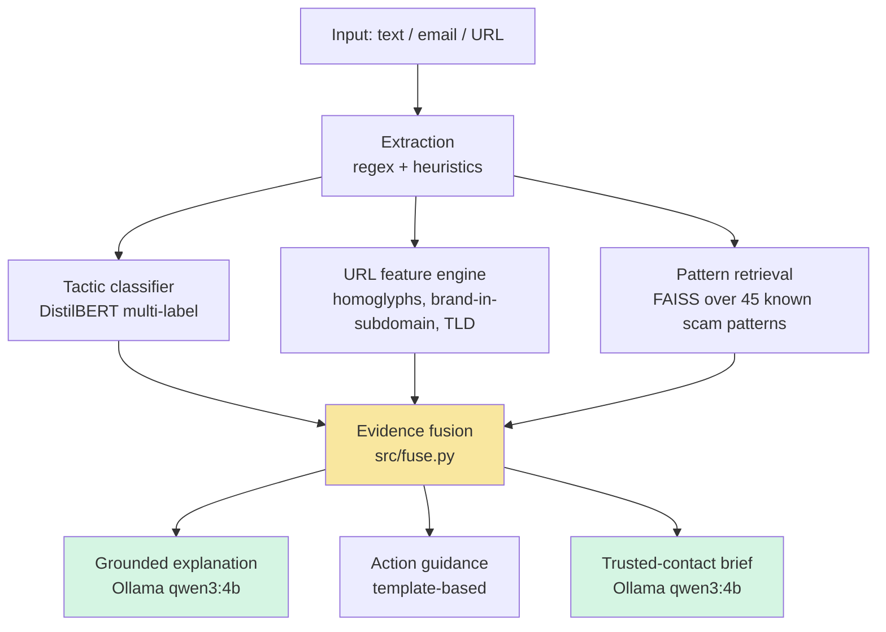

# Second Look

> Paste a suspicious message. Get the tactic, the evidence, what to do next — and a message you can send to someone you trust.

[](https://www.python.org/)
[](#track)
[](#privacy)

**ForgeHacks 2026 submission — AI + Cybersecurity track.**

---

## The Problem

Fraud losses hit **$12.5 billion in the US alone in 2023** (FTC), with the highest per-incident losses among adults 60+. But the reason people fall for scams is not that they don't know scams exist. It's that every scam tactic — urgency, authority impersonation, secrecy — is designed to **isolate the target and rush the decision**. Existing defenses don't touch this:

- **Spam filters are silent and binary.** They block or don't block. No explanation, no teaching, no path forward when they fail.
- **Pasting a scam into a public chatbot** leaks bank details, phone numbers, and personal messages to a third party.
- **Bank and government advisories** are static lists of examples that go stale, written above the reading level of the people most targeted.
- **Nothing exists that produces a second opinion.** The single most protective factor against scams is not being alone with the message — but no consumer tool is designed to manufacture that second opinion.

**Second Look** addresses the isolation vector directly. It analyzes the message locally, names the tactic in plain language, tells the user what to do, and — critically — generates a short brief the user can forward to a family member or friend asking them to weigh in. The AI's job isn't just detection. It's to make asking for help frictionless in the moment it matters most.

**Target users:** non-technical adults and older adults (highest loss rates); family members who get the "is this real?" forwarded message; small businesses facing business email compromise.

---

## What It Does

Given a suspicious SMS, email, DM, or chat log, Second Look returns:

1. **Detected tactics** — which of 7 manipulation patterns the message uses (urgency, authority impersonation, financial lure, credential harvesting, payment redirection, secrecy, tech support).
2. **Evidence** — the specific URLs, keywords, and matched known-scam patterns behind the decision.
3. **A plain-language explanation** — grounded in the structured evidence, not freeform generation.
4. **Action steps** — ordered by priority: what to do now, how to verify, where to report.
5. **A trusted-contact brief** — a short, warm message the user can send to someone they trust, written for *that person*, not for the user.


---

## How It Works



**Components:**

| Stage | What | Why |
|---|---|---|
| Extraction | Deterministic regex/heuristics for URLs, phones, amounts, brands, and keyword signals | Auditable, explainable, no AI needed |
| Tactic classifier | DistilBERT fine-tuned for multi-label classification over 7 tactics | Multi-label because real scams layer tactics |
| URL feature engine | Lexical + Unicode confusable detection (homoglyphs), brand-in-subdomain, suspicious TLDs | Catches phishing that text-only classifiers miss |
| Pattern retrieval | Sentence-transformer embeddings + FAISS over a curated corpus of 45 known scam patterns | Grounds the explanation in real prior cases |
| Fusion | `src/fuse.py` — single code path used by both the app and the eval harness | What the eval measures is what the app does |
| Explanation | Ollama `qwen3:4b-instruct-2507-q8_0`, constrained to the structured evidence | Grounded generation — cannot invent red flags |
| Guidance | Template-based action steps keyed to tactics and decision band | Deterministic; never fails on demo day |

**Why not just prompt an LLM?** A zero-shot LLM matches our recall (0.932 vs 0.960) but has much worse precision (0.613 vs 0.868) and runs at ~2.7 items/s vs our 53 items/s — **~20× slower** on the same machine. Second Look's architecture is a fine-tuned classifier plus retrieval plus a grounded generator, evaluated against both a keyword-rule baseline and a zero-shot LLM baseline.

### Privacy is a feature, not an implementation detail

All inference — classifier, embeddings, retrieval, and the LLM explanation — runs **locally** via Ollama. No message content leaves the user's machine. A tool that asks you to paste your bank SMS into a server is self-defeating.

---

## Results

Evaluated on a **300-row balanced held-out sample** (from the ScamBench validation split, `should_trigger_scam_defense` as ground truth), using the **exact fusion logic** the app runs (`src/fuse.py`):

| System | Accuracy | Precision | Recall |
|---|---|---|---|
| Keyword rules baseline | 0.657 | 0.737 | 0.447 |
| Zero-shot `qwen3:4b` | 0.675 | 0.613 | 0.932 |
| **Second Look** | **0.907** | **0.868** | **0.960** |

**Tactic-level** (full validation split, 2,753 rows):
- f1_micro: **0.838**
- f1_macro: **0.797** (best epoch 2)

Second Look **matches the zero-shot LLM's recall while raising precision by 25 points** — and runs at ~20× the throughput. On the same machine, the local pipeline processes ~53 messages/sec where the standalone LLM does 2.7.

### An OOD false-positive we found and fixed

Our first fused smoke test flagged a plain Amazon delivery notification as SCAM (75/100, `credential_harvesting` 0.68). Root cause: ScamBench's `legitimate` class is multi-turn agent conversations, so **one-shot legitimate notifications** ("Your package is arriving today, track at amazon.com/x") were out-of-distribution for the classifier — exactly the false-positive class `label_schema.md` §4 warns about.

**Fix:** we added 854 curated benign examples (54 template delivery/bank/2FA notifications with real-brand URLs + 800 SMS ham rows) and retrained. **No thresholds were touched.** Val f1_macro went **0.7610 → 0.7969**. The Amazon notification now scores SUSPICIOUS 47/100 — appropriate, since a notification with a link *is* worth a second look even when it's real.

Reproduce: `eval/results_binary.csv`, `eval/metrics.json`.

---

## Quickstart

Requires Python 3.11+ and [Ollama](https://ollama.com/download).

```bash
# 1. Install Ollama and pull the model
ollama pull qwen3:4b-instruct-2507-q8_0

# 2. Install Python dependencies
pip install -r requirements.txt

# 3. Download models and build the pattern index
python download_models.py
python train/build_pattern_index.py

# 4. Launch the app
streamlit run app.py
```

**Optional — retrain the classifier:**
```bash
python train/prepare_scambench.py
python train/train_tactic_classifier.py --data data/labeled.csv
```

**Optional — reproduce the evaluation:**
```bash
python eval/evaluate.py
```

---

## Limitations & Safety

Honest scope, per Devpost submission requirement.

- **The `tech_support` tactic does not cross the 0.5 confidence threshold** even on obvious tech-support scams. Upsampling from 61 to 330 positives was not enough to overcome the low signal in the source data. When a tech-support scam appears, the decision is still correct — other tactics (urgency, authority) carry the score — but the tactic tag itself is not surfaced. Worth one honest line in the video.
- **English only.** ScamBench covers 14 languages; we filtered to English for the classifier.
- **Trained on ScamBench + curated benign examples.** May not generalize to scam types not represented in the source data.
- **1,411 agent-security rows** (research-assisted, admin-override, prompt-injection variants) were excluded from training rather than labeled all-zero, because they describe attacks on AI agents, not human scams. Documented in `label_schema.md`.
- **Decision support, not a legal or financial determination.** When in doubt, contact the bank or institution through a channel you chose, not one provided by the message.
- **`qwen3:4b` occasionally produces explanations that are technically correct but verbose.** The template fallback exists if the LLM is unavailable.
- We did not run a user study. We do not claim measured reductions in fraud loss.

---

## Impact

- **Direct:** anyone who receives a suspicious message and doesn't have a technical person to ask.
- **Indirect:** family members and caregivers, by turning "is this real?" into a fast, low-friction exchange.
- **Structural:** moves the design center of scam defense from *detection* (which is already commoditized by Google and Microsoft) to *behavior* (which is not).
- **Extensible:** the fusion + guidance + brief pipeline generalizes to any message-based risk: payroll redirection, invoice fraud, romance scams, pig-butchering.

---

## Track

**AI + Cybersecurity** — *"Build an AI-powered solution that helps people recognize, prevent, verify, or respond to scams, impersonation, and fraud enabled by AI or modern technologies."*

Second Look addresses **recognize** (tactic labels + evidence), **verify** (channel-you-chose guidance, trusted-contact brief), and **respond** (priority-ordered action steps + escalation path if the user already acted).

---

## Repository Layout

```
second-look/
├── app.py                          # Streamlit entry point
├── download_models.py              # One-time model/data setup
├── requirements.txt
├── src/
│   ├── extract.py                  # Deterministic entity extraction
│   ├── features_url.py             # URL + homoglyph analysis
│   ├── classify.py                 # Tactic classifier inference
│   ├── retrieve.py                 # FAISS pattern retrieval
│   ├── fuse.py                     # Evidence fusion (shared by app + eval)
│   ├── explain.py                  # Ollama grounded generation
│   └── guidance.py                 # Action steps + trusted-contact brief
├── train/
│   ├── prepare_scambench.py        # Dataset prep + tactic mapping
│   ├── train_tactic_classifier.py  # DistilBERT fine-tune
│   ├── build_pattern_index.py      # FAISS index build
│   └── mine_patterns.py            # Auto-mine patterns from ScamBench
├── eval/
│   ├── evaluate.py                 # Baselines + Second Look comparison
│   ├── results_binary.csv
│   └── metrics.json
├── data/
│   ├── patterns/scam_patterns.jsonl   # 45 curated scam patterns
│   └── raw/                            # gitignored (downloaded by script)
├── models/                             # gitignored
├── assets/
│   ├── architecture.png
│   └── screenshot_*.png
└── label_schema.md
```

---

## Acknowledgements

Built during **ForgeHacks 2026**. Dataset: [ScamBench](https://huggingface.co/datasets/shaw/scambench-training). Local LLM: [Ollama](https://ollama.com) with `qwen3:4b-instruct-2507-q8_0`.