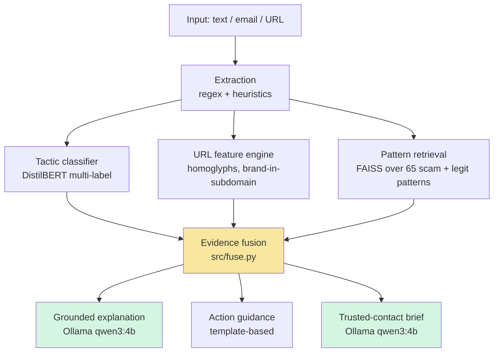

# Second Look

> Paste a suspicious message. Get the tactic, the evidence, what to do next — and a message you can send to someone you trust.

[](https://www.python.org/)
[](#track)
[](#how-it-works)

**ForgeHacks 2026 — AI + Cybersecurity track**

**100% local inference — classifier, retrieval, and LLM all run on your machine. Nothing you paste is uploaded anywhere.**

[Demo video](YOUR_YT_LINK) · [Try it locally](#quickstart) · [Results](#results)

---

## The Problem

**Renu is 68. She lives in Pune. Her son lives in Toronto.** Three times a week she gets a message she can't quite judge — a bank alert, an insurance refund, a delivery notice. She forwards it to her son. He's asleep. She waits. Sometimes she clicks anyway.

Second Look is for Renu.

Fraud losses hit **$12.5 billion in the US alone in 2023** (FTC), with the highest per-incident losses among adults 60+. But scammers don't succeed because people don't know scams exist. They succeed because they **isolate you, rush you, and make asking for help feel embarrassing.** Every scam tactic — urgency, authority impersonation, secrecy — exists to prevent the second opinion. Existing defenses don't touch this:

- **Spam filters are silent and binary.** They block or don't block. No explanation, no teaching, no path forward when they fail.
- **Pasting a scam into a public chatbot** leaks bank details, phone numbers, and personal messages to a third party.
- **Bank and government advisories** are static lists of examples that go stale, written above the reading level of the people most targeted.
- **Nothing manufactures a second opinion.** The single most protective factor against a scam is not being alone with the message — and no consumer tool is designed to produce that second opinion.

**Second Look addresses the isolation vector directly.** It analyzes the message locally, names the tactic in plain language, tells the user what to do, and — critically — generates a short brief the user can forward to a family member or friend asking them to weigh in.

**Target users:** older adults like Renu and their families (highest loss rates, and the "is this real?" forward is already how they try to cope); anyone without a technical person to ask; small businesses facing business email compromise.

---

## What It Does

Given a suspicious SMS, email, DM, or chat log, Second Look returns:

1. **Detected tactics** — which of 7 manipulation patterns the message uses.
2. **Evidence** — the specific URLs, keywords, and matched known-scam patterns behind the decision.
3. **A plain-language explanation** — grounded in the structured evidence and the original message — it cannot invent red flags.
4. **Action steps** — ordered by priority: what to do now, how to verify, where to report.
5. **A trusted-contact brief** — a short, warm message the user can send to someone they trust, written for *that person*. Renu can send it to her son at 2 AM his time; she doesn't have to explain what a phishing URL is — Second Look already did. She just has to hit send.


---

## How It Works



| Stage | What | Why |
|---|---|---|
| Extraction | Deterministic regex/heuristics for URLs, phones, amounts, brands, keyword signals | Auditable, no AI needed |
| Tactic classifier | DistilBERT fine-tuned for multi-label classification over 7 tactics | Real scams layer tactics |
| URL feature engine | Lexical + Unicode confusable detection, brand-in-subdomain, suspicious TLDs | Catches phishing text-only classifiers miss |
| Pattern retrieval | Sentence-transformer embeddings + FAISS over 65 curated scam **and legitimate** patterns | Grounds the explanation in real prior cases; catches template scams the classifier has never seen |
| Fusion | `src/fuse.py` — single code path shared by app and eval | What the eval measures is what the app does |
| Explanation | Ollama `qwen3:4b`, constrained to the message + evidence | Grounded generation — cannot invent red flags; deterministic template fallback if the LLM is unavailable |
| Guidance | Template-based action steps keyed to tactics and decision band | Deterministic; never fails on demo day |

**Why not just prompt an LLM?** A zero-shot LLM matches our recall but has far worse precision (0.613 vs 0.855) and runs at ~2.7 items/s vs our ~53 items/s — **~20× slower** on the same machine. Second Look is a fine-tuned classifier plus retrieval plus a grounded generator, evaluated against both a keyword-rule baseline and a zero-shot LLM baseline.

**Privacy is a feature, not an implementation detail.** All inference — classifier, embeddings, retrieval, and the LLM explanation — runs **locally** via Ollama. No message content leaves the user's machine. A tool that asks you to paste your bank SMS into a server is self-defeating.

---

## Results

Evaluated on a **300-row balanced held-out sample** (`should_trigger_scam_defense` as ground truth), using the **exact fusion logic** the app runs:

| System | Accuracy | Precision | Recall | F1 |
|---|---|---|---|---|
| Keyword rules | 0.657 | 0.737 | 0.487 | 0.586 |
| Zero-shot `qwen3:4b` | 0.675 | 0.613 | 0.932 | 0.740 |
| **Second Look** | **0.907** | **0.855** | **0.980** | **0.913** |

**Tactic-level** (full 2,920-row val split, per-tactic thresholds): f1_micro **0.833**, f1_macro **0.821**.

Per-tactic F1-optimal thresholds (tuned on val by `train/tune_thresholds.py`):

| Tactic | Threshold | F1 |
|---|---|---|
| urgency | 0.30 | 0.850 |
| authority | 0.35 | 0.836 |
| financial_lure | 0.70 | 0.944 |
| credential_harvesting | 0.45 | 0.861 |
| payment_redirection | 0.60 | 0.919 |
| secrecy | 0.50 | 0.803 |
| tech_support | 0.60 | 0.533 |

Second Look **exceeds the zero-shot LLM's recall (0.980 vs 0.932) while raising precision by 24 points**, at ~20× the throughput.

### Ablation — what each component actually contributes

`eval/ablation.py` re-runs the eval with components disabled (cached evidence, production `fuse()` path):

| System | Accuracy | Precision | Recall | F1 |
|---|---|---|---|---|
| Full Second Look | 0.907 | 0.855 | 0.980 | 0.913 |
| − URL features | 0.907 | 0.855 | 0.980 | 0.913 |
| − Retrieval | 0.907 | 0.855 | 0.980 | 0.913 |
| − Tactic classifier | 0.520 | 1.000 | 0.040 | 0.077 |
| − Fusion formula (plain max) | 0.900 | 0.857 | 0.960 | 0.906 |

Honest reading: on this benchmark the **tactic classifier carries the binary decision** — remove it and F1 collapses to 0.077. URL features and retrieval show no binary delta *here* because ScamBench scams are tactic-heavy, so the classifier already covers them; and our fusion formula buys +2pt recall over a naive max.

But the benchmark under-credits the redundant components, because it doesn't contain their designed failure mode. **Adversarial probe** — a template phish with quiet text and a fresh domain (`"USPS: your package could not be delivered. Pay the 1.99 redelivery fee within 12 hours: usps-redelivery.top"`):

- Tactic classifier top probability: **0.029** — a miss on its own
- URL features: risk 15 — a miss on its own
- Retrieval: matches the known *"Package redelivery fee"* pattern at **0.95 similarity**
- **Full system: `scam` 83/100. Without retrieval: `likely_legitimate` 15/100 — a miss.**

Retrieval is what catches scams that are new to the classifier but not new to the world. URL features primarily surface *displayed evidence* (the "why" panel) even when the classifier carries the score. The components are non-redundant across the failure-mode space, not within one benchmark.

### Two false positives we found and fixed

**1. The Amazon delivery notification.** Our first fused smoke test flagged a legit Amazon delivery notification as SCAM 75/100 (`credential_harvesting` 0.68). Root cause: ScamBench's `legitimate` class is multi-turn agent conversations, so one-shot legitimate notifications were out-of-distribution. **Fix:** added 854 curated benign examples (54 template notifications with real-brand URLs + 800 SMS ham rows) and retrained. **No thresholds were touched.** Val f1_macro 0.7610 → 0.7969. The Amazon notification now scores `likely_legitimate` 10/100.

**2. The doctor's appointment.** After the OOD fix, a legitimate appointment reminder returned SUSPICIOUS 56/100 with a hallucinated explanation about a "fake delivery link." Two root causes: the explanation LLM was called without the original message and described a retrieved pattern as if it were the message; and the retrieval floor (0.3) let a weak 0.48 match contribute to the risk. **Fix:** pass the message into the prompt, constrain the LLM to describe only what's in the message, raise the retrieval floor to 0.6, add 20 curated legitimate patterns to the corpus, and reduce pattern weight in fusion. The same message now returns `likely_legitimate` 19/100 with no hallucinated details.

### Regression suite (all 5 demo messages green)

| Message | Verdict |
|---|---|
| Doctor appointment (legit) | `likely_legitimate` 19/100 ✓ |
| Amazon delivery (legit) | `likely_legitimate` 10/100 ✓ |
| SBI phishing SMS | `scam` 100/100 (4 tactics) ✓ |
| Microsoft tech-support scam | `scam` 96/100 ✓ |
| Lottery advance-fee | `scam` 98/100 ✓ |

Reproduce: `eval/results_binary.csv`, `eval/metrics.json`, `eval/cached_evidence.jsonl`.

---

## Quickstart

Requires Python 3.11+ and [Ollama](https://ollama.com/download).

```bash
# 1. Install Ollama and pull the model
ollama pull qwen3:4b-instruct-2507-q8_0

# 2. Install Python dependencies
pip install -r requirements.txt

# 3. Download the fine-tuned classifier + base models, then build the pattern index
python download_models.py
python train/build_pattern_index.py

# 4. Launch the app
streamlit run app.py
```

The fine-tuned classifier is hosted at [`YOUR_HF_USERNAME/second-look-classifier`](https://huggingface.co/YOUR_HF_USERNAME/second-look-classifier) and downloaded automatically by `download_models.py` (set your username in `download_classifier()`). If you'd rather train locally, the next section shows how.

**To reproduce training from scratch:**

```bash
python train/prepare_scambench.py
python train/train_tactic_classifier.py --data data/labeled.csv
python train/tune_thresholds.py --data data/labeled.csv
python train/build_pattern_index.py
```

**To reproduce the evaluation and ablation:**

```bash
python eval/evaluate.py    # builds eval/cached_evidence.jsonl
python eval/ablation.py
```

---

## Limitations & Safety

Honest scope, per Devpost submission requirement.

- **`tech_support` is not F1-competitive** (F1 0.533 at its tuned threshold 0.60). The source data has only 80 positives for this tactic; upsampling to 330 in training did not overcome the weak signal. When a tech-support scam appears, the decision is still correct — other tactics carry the score — but the tactic tag itself is unreliable.
- **English only.** ScamBench covers 14 languages; we filtered to English for the classifier.
- **Trained on ScamBench + curated benign examples.** May not generalize to scam types not represented in the source data.
- **1,411 agent-security rows** (research-assisted, admin-override, prompt-injection variants) were excluded from training rather than labeled all-zero, because they describe attacks on AI agents, not human scams.
- **Decision support, not a legal or financial determination.** When in doubt, contact the bank or institution through a channel you chose, not one provided by the message.
- **We did not run a user study.** We do not claim measured reductions in fraud loss.

---

## Impact

- **Direct:** older adults like Renu, and anyone who receives a suspicious message and doesn't have a technical person to ask.
- **Indirect:** family members and caregivers, by turning "is this real?" into a fast, low-friction exchange across time zones.
- **Structural:** moves the design center of scam defense from *detection* (commoditized by Google and Microsoft) to *behavior* — manufacturing the second opinion scammers exist to prevent.
- **Extensible:** the fusion + guidance + brief pipeline generalizes to payroll redirection, invoice fraud, romance scams, pig-butchering.

---

## Track

**AI + Cybersecurity** — *"Build an AI-powered solution that helps people recognize, prevent, verify, or respond to scams, impersonation, and fraud enabled by AI or modern technologies."*

Second Look addresses **recognize** (tactic labels + evidence), **verify** (channel-you-chose guidance + trusted-contact brief), and **respond** (priority-ordered action steps + escalation path).

---

## Repository Layout

```
second-look/
├── app.py                          # Streamlit entry point
├── download_models.py              # One-time model/data setup (classifier from HF Hub)
├── requirements.txt
├── src/
│   ├── extract.py                  # Deterministic entity extraction
│   ├── features_url.py             # URL + homoglyph analysis
│   ├── classify.py                 # Tactic classifier inference (per-tactic thresholds)
│   ├── retrieve.py                 # FAISS pattern retrieval (65 patterns)
│   ├── fuse.py                     # Evidence fusion (shared by app + eval)
│   ├── explain.py                  # Ollama grounded generation + template fallback
│   └── guidance.py                 # Deterministic action steps
├── train/
│   ├── prepare_scambench.py        # Dataset prep + tactic mapping + benign negatives
│   ├── train_tactic_classifier.py  # DistilBERT fine-tune (+ rare-tactic upsampling)
│   ├── tune_thresholds.py         # Per-tactic F1-optimal thresholds
│   ├── build_pattern_index.py      # FAISS index build
│   └── mine_patterns.py            # Auto-mine patterns from ScamBench
├── eval/
│   ├── evaluate.py                 # Baselines + Second Look comparison (+ evidence cache)
│   ├── ablation.py                 # Component ablation
│   ├── grid_fusion.py              # Fusion constant tuning
│   ├── results_binary.csv
│   └── metrics.json
├── data/
│   ├── patterns/scam_patterns.jsonl   # 65 patterns (45 scam + 20 legitimate)
│   ├── labeled.csv                     # Training data (ScamBench + benign negatives)
│   └── raw/                            # source corpora
├── models/                             # classifier weights hosted on HF Hub; index built locally
└── assets/
```

---

## Acknowledgements

Built during **ForgeHacks 2026**. Dataset: [ScamBench](https://huggingface.co/datasets/shaw/scambench-training). Local LLM: [Ollama](https://ollama.com) with `qwen3:4b-instruct-2507-q8_0`.
